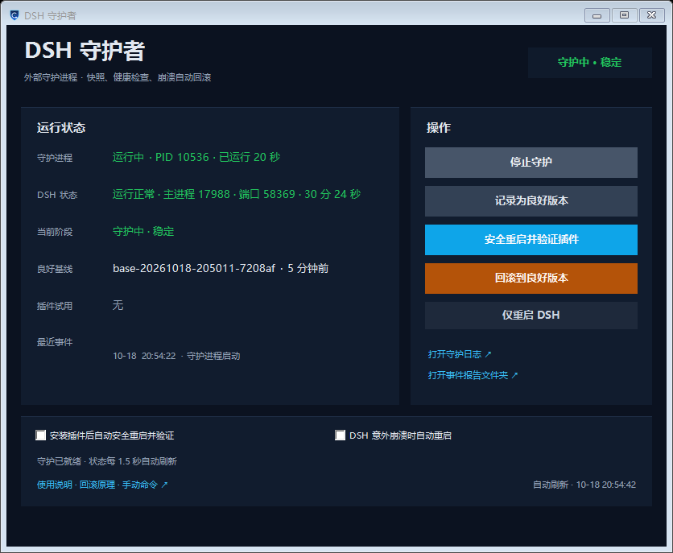

# DSH 守护者（DSH Guardian）

一个**运行在 DSH 之外**的独立守护进程：它会记录 DSH 的最新良好状态；当你安装新插件后，如果插件在加载或运行中导致 DSH 崩溃、启动失败或服务无响应，它会自动**停止 DSH → 恢复安装前的插件配置 → 重启 DSH → 验证恢复**，并留下事件报告。

> 为什么必须是“另一个进程”？
> 如果监控器作为 DSH 的插件运行，它会和 DSH 一起崩溃，无法把倒下的 DSH 扶起来。所以“另一个我”是一个独立的 Node 守护进程 + 一个 WinForms 控制面板，它们不依赖 DSH 存活。



文档：[架构说明](docs/ARCHITECTURE.md) · [测试说明](docs/TESTING.md) · [安全说明](SECURITY.md) · [更新日志](CHANGELOG.md)

仓库：[github.com/jiiasf/dsh-guardian](https://github.com/jiiasf/dsh-guardian)

---

## 仓库结构

```text
guardian.mjs          CLI 入口（start / stop / status / snapshot / verify / rollback …）
lib/                  守护核心：配置、进程、profile、快照、状态机、报告
panel/                WinForms 控制面板 + 启动器
assets/               应用图标（ico/png）与生成脚本
test/                 模拟 DSH 的端到端回滚测试
docs/                 架构与测试文档
install-shortcuts.ps1 桌面快捷方式与登录自启
config.example.json   配置模板（真正的 config.json 不入库）
```

---

## 它做什么

| 能力 | 说明 |
| --- | --- |
| 健康监控 | 每 4 秒检查 DSH 主进程、Agent 宿主进程、Web 端口和 HTTP 响应（401 也算正常） |
| 变更检测 | 监控 profile 的 `package.json`、`cordis.patch.yml`、`cordis.yml`、`pnpm-lock.yaml`、`compatibility.json` 以及 `node_modules` 指纹 |
| 良好基线 | 在 DSH 健康且配置稳定时创建快照，作为“安装这个插件之前的最新版本” |
| 试用期 | 新插件真正加载（DSH 重启）后观察 3 分钟；期间崩溃立即回滚 |
| 启动失败回滚 | 重启后 120 秒内没有恢复健康，自动回滚并再次启动验证 |
| 证据报告 | 记录进程/HTTP/端口、profile 差异、pnpm 日志、Windows 崩溃事件和事件时间线 |
| 手动操作 | 记录良好版本、安全重启验证、立即回滚、仅重启 DSH、暂停/恢复 |
| 桌面入口 | 桌面快捷方式 + 登录后后台自启 |

---

## 快速开始

1. 双击桌面上的 **「DSH 守护者」**。
2. 首次打开会自动启动守护进程；如果 DSH 正在正常运行，几秒后会自动建立第一个良好基线。
3. 正常安装插件即可。守护会检测到 profile 变化，并显示 **“检测到变更 · 等待加载”**。
4. 当 DSH 重启加载插件后：
   - 启动成功 → 进入 **试用期**（默认 180 秒）；
   - 试用期通过 → 当前状态被记录为新的良好版本；
   - 启动失败/崩溃/服务无响应 → 自动回滚到上一个良好版本并重启 DSH。

面板上的按钮：

- **停止/启动守护**：停止后不再自动回滚，但已有快照仍保留。
- **记录为良好版本**：手动把当前状态记为基线。仅在 DSH 正常时使用。
- **安全重启并验证插件**：立即重启 DSH 让新插件加载，并进入试用期；失败自动回滚。
- **回滚到良好版本**：手动触发一次完整回滚。
- **仅重启 DSH**：不改变插件配置，只重启。
- **打开守护日志 / 事件报告文件夹**：排查用。
- 两个开关：安装后自动安全重启验证、DSH 意外崩溃时自动重启（默认关闭，避免把“主动退出”误判为崩溃）。

> 回滚会重启 DSH，当前对话会中断；DSH 会话是持久化的，重新打开后可以继续。

---

## 安装与卸载

### 从 GitHub 获取

```powershell
git clone https://github.com/jiiasf/dsh-guardian.git
cd dsh-guardian

# 首次运行：生成本机 config.json（会把 nodeExe 指向当前 Node）
node guardian.mjs init

# 如果 DSH 不在默认位置，编辑 config.json 的 appExe / profileDir；然后：
powershell -ExecutionPolicy Bypass -File install-shortcuts.ps1
```

> 仓库不包含 `config.json`（它含本机绝对路径）；首次运行会生成。模板见 [`config.example.json`](config.example.json)。

### 创建/删除快捷方式

```powershell
# 创建桌面快捷方式 + 登录自启（默认）
powershell -ExecutionPolicy Bypass -File install-shortcuts.ps1

# 只创建桌面快捷方式，不注册自启
powershell -ExecutionPolicy Bypass -File install-shortcuts.ps1 -NoStartup

# 删除桌面和启动项快捷方式（不会删除守护程序、快照或日志）
powershell -ExecutionPolicy Bypass -File install-shortcuts.ps1 -Remove
```

生成的文件：

- 桌面：`DSH 守护者.lnk`
- 启动文件夹：`DSH 守护者（后台）.lnk`（`shell:startup`）
- 程序目录：本仓库目录
- 运行数据：`%USERPROFILE%\.dsh-guardian\`（可用 `DSH_GUARDIAN_HOME` 覆盖）

---

## 工作流程（状态机）

```text
             ┌─────────────┐
   DSH 健康  │   stable    │  守护中
             └──────┬──────┘
                    │ profile 指纹变化（安装/启用插件、改配置）
                    ▼
             ┌─────────────┐
             │  awaiting   │  等待 DSH 重启加载
             └──────┬──────┘
          DSH 重启并健康 │ 启动失败/超时/崩溃
                    ▼              └──────────────┐
             ┌─────────────┐                      │
             │  probation  │  试用期 3 分钟        │
             └──────┬──────┘                      │
        试用通过      │      期间崩溃/无响应        │
                    ▼              ▼               ▼
             ┌─────────────┐  ┌──────────────────────┐
             │   promote   │  │ rollback → 恢复基线   │
             │ 新良好版本   │  │ 隔离问题包 → 重启验证 │
             └─────────────┘  └──────────────────────┘
```

- **基线（baseline）** 是“安装这个插件之前的最新良好版本”。检测到变更时基线不会改变，只有试用期通过才推进。
- 如果插件安装后你一直不重启 DSH，守护会一直停在 `awaiting`，不会误把未加载的插件当成已通过。
- 如果 DSH 在插件窗口内退出且**没有** Windows 崩溃记录，守护会认为可能是你主动退出，**不会**自动回滚或强行启动；下次启动 DSH 时继续验证。（若开启了 `autoVerify`，守护会主动重启来验证，失败再回滚。）

---

## 命令行

```powershell
node guardian.mjs status            # 查看状态
node guardian.mjs start             # 后台启动守护
node guardian.mjs stop              # 停止守护
node guardian.mjs snapshot          # 记录当前为良好版本
node guardian.mjs verify            # 安全重启 + 验证插件
node guardian.mjs rollback --yes    # 回滚到最近良好版本
node guardian.mjs rollback --dry-run --yes  # 演练：只生成报告，不动 DSH
node guardian.mjs history           # 快照历史（★ 当前基线）
node guardian.mjs incidents         # 事件报告列表
node guardian.mjs doctor            # 环境自检
node guardian.mjs selftest          # 离线自检（不接触真实 DSH）
node guardian.mjs pause / resume    # 暂停/恢复守护动作
node guardian.mjs dismiss           # 清除“需要处理”提醒
node guardian.mjs config list       # 查看配置
node guardian.mjs config set autoVerify true
```

所有写操作都通过守护进程执行，避免 CLI 与守护同时改状态。

---

## 配置（`config.json`）

配置模板见 [`config.example.json`](config.example.json)；复制为 `config.json` 后修改路径，或运行 `node guardian.mjs init` 自动生成。

| 键 | 默认 | 说明 |
| --- | --- | --- |
| `profile` | `desktop` | 要守护的 DSH profile |
| `dshHome` | `%USERPROFILE%\.dsh` | DSH 数据目录 |
| `profileDir` | 空（自动 `<dshHome>\profiles\<profile>`） | profile 目录 |
| `appExe` | `D:\DSH\DeepSeek Harness.exe` | DSH 可执行文件 |
| `appProcessName` | `DeepSeek Harness.exe` | 进程名 |
| `nodeExe` | 自动检测 | 运行守护的 Node |
| `intervalMs` | `4000` | 健康检查间隔 |
| `settleMs` | `5000` | profile 指纹稳定多久才认为变更完成 |
| `probationMs` | `180000` | 试用期（毫秒） |
| `startupGraceMs` | `120000` | 重启后等待健康的上限 |
| `crashConfirmMs` | `20000` | 连续异常多久才认定为崩溃 |
| `failureThreshold` | `3` | 连续失败次数阈值 |
| `verifyDelayMs` | `20000` | 自动验证延迟 |
| `autoVerify` | `false` | 安装插件后自动安全重启验证 |
| `autoRollback` | `true` | 允许自动回滚 |
| `autoRestartStable` | `false` | 无插件变更时崩溃是否自动重启 |
| `notify` | `true` | 桌面通知 |
| `observeOnly` | `false` | 只观察，不执行任何动作 |
| `dryRun` | `false` | 演练模式 |
| `maxSnapshots` | `12` | 保留快照数 |
| `maxHistory` | `10` | 良好版本历史长度 |

---

## 数据与文件

```text
%USERPROFILE%\.dsh-guardian\
├─ state.json                 当前状态机
├─ runtime\
│  ├─ status.json             面板读取的实时状态
│  ├─ daemon.lock             单实例锁
│  └─ stop.request            停止请求
├─ snapshots\<快照ID>\
│  ├─ meta.json               文件哈希、依赖、组合包、指纹
│  └─ files\                  profile 清单文件副本
├─ incidents\<事件ID>\
│  ├─ incident.md             中文事件报告
│  ├─ evidence.json           结构化证据
│  ├─ profile-diff.txt        变更对比
│  ├─ pnpm.log                最近一次插件安装日志（若有）
│  └─ guardian.log.tail.txt   守护日志尾部
├─ quarantine\<事件ID>\       被隔离的问题插件
└─ logs\guardian.log          守护日志（JSON 行 + 文本）
```

**只回滚 profile 配置**：`package.json`、`pnpm-lock.yaml`、`pnpm-workspace.yaml`、`cordis*.yml`、`compatibility.json`、`.npmrc` 等清单文件。不会碰会话、凭据、工作区或你的项目文件。新增的问题依赖会从 `node_modules` 移到隔离目录，避免继续被加载。

---

## 限制与注意事项

1. **守护必须先运行**。如果 DSH 已经崩溃、守护没启动，就无法自动回滚；可双击桌面图标启动后再点“回滚”。
2. **只检测进程级健康**。插件导致的“静默功能异常”（界面还在、但功能坏了）不会被自动识别；可在面板点“安全重启并验证插件”或手动回滚。
3. **回滚会重启 DSH**，当前对话会短暂中断；会话内容持久化，不会丢失。
4. **不要同时运行两个守护实例**。单实例锁会阻止，但请勿手动改状态目录并发操作。
5. **Windows 通知**依赖系统通知设置；如果没看到气泡，面板和报告仍然可用。
6. **插件安装过程本身**由 DSH 插件管理器负责；守护在安装写入稳定后才记录变更。安装失败时 DSH 自己会恢复清单，守护通常只会看到一次短暂变化。
7. 事件报告保存在本机，可能包含路径、包名和错误文本；分享前请自行检查。

---

## 故障排查

- **面板显示“未运行”**：点“启动守护”，或运行 `node guardian.mjs start`；再看 `doctor`。
- **基线丢失**：守护会提示；在 DSH 正常时点“记录为良好版本”。
- **回滚失败**：打开 `incidents\<ID>\incident.md`，其中包含进程、HTTP、崩溃日志和后续建议；可在 DSH 插件页禁用最近安装的插件，或 `dsh plugin --profile desktop remove <包名>`。
- **守护自己异常**：`node guardian.mjs doctor`、`node guardian.mjs selftest`；日志在 `%USERPROFILE%\.dsh-guardian\logs\guardian.log`。
- **想完全停用**：面板“停止守护”，并运行 `install-shortcuts.ps1 -Remove` 删除自启；程序与历史数据不会自动删除。

---

## 给“下一个我”的接手说明

如果 DSH 刚经历崩溃/回滚，先读最新事件报告：

```powershell
node guardian.mjs incidents
```

报告中的“变更摘要”会指出可疑插件，“回滚结果”会说明恢复了哪个快照。需要继续排查时：

```powershell
node guardian.mjs status --json
node guardian.mjs history
node guardian.mjs doctor
```

在未确认插件安全前，不要把它重新加入基线；先修复或移除，再在面板点“记录为良好版本”。

---

## 自检

```powershell
node guardian.mjs selftest
```

自检在临时目录中创建假 profile，验证：指纹采集、快照、插件依赖差异、恢复、试用期通过、试用期崩溃回滚、崩溃证据分支，以及“诊断失败不误判为崩溃”。它**不会**停止或重启真实的 DSH。

完整端到端演练（用 `test/FakeDsh.exe` 模拟一个会启动失败、也会在加载后崩溃的 DSH，验证真实的停止进程 → 恢复快照 → 重新启动 → 健康检查 → 自动回滚链路）：

```powershell
node test\fake-rollback-test.mjs
```

该测试只在 `%TEMP%` 下工作，不会接触真实的 DSH 或真实 profile。详细说明见 [测试文档](docs/TESTING.md)。

---

## 打包发布

仓库已按“源码仓库”组织；`config.json`、`node_modules`、`dist`、运行日志和测试生成的 exe 都不会入库。

```powershell
# 生成只包含已提交文件的 zip（dist/ 已被 .gitignore 忽略）
git archive --format=zip --output=dist\dsh-guardian-1.0.2.zip HEAD

# 校验
Get-FileHash dist\dsh-guardian-1.0.2.zip -Algorithm SHA256
```

---

## 许可证

本项目从 **v1.0.2** 起采用 [Apache License 2.0](LICENSE)，Copyright 2026 jiiasf，署名信息见 [NOTICE](NOTICE)。

历史版本 **v1.0.0 / v1.0.1** 仍按 MIT License 发布，不会被覆盖；需要旧许可证时请查看对应 tag 中的 `LICENSE`。
